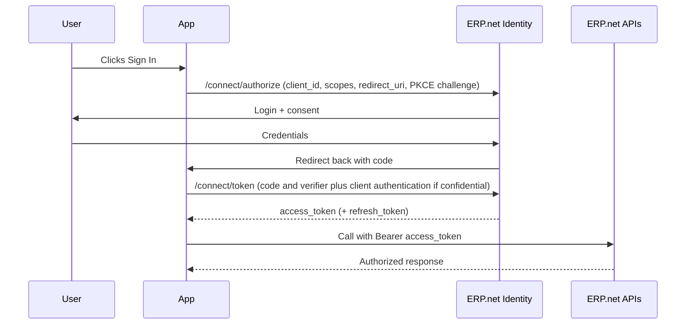

# Step-by-Step: Authorization Code Flow

This guide walks through the exact HTTP steps an interactive app takes to sign in a user with the @@name Identity, exchange the authorization code for tokens, and call the APIs.

Use Authorization Code with PKCE for both **confidential** web apps and **public** clients such as SPAs. If the registration supports Hybrid, the target Identity site must run **ERP.net 27.1.2.8 or later** to use `response_type=code` with PKCE. See [Current support and migration](overview.md#current-support-and-migration).

## Prerequisites

Register your app as a **Trusted Application** in the target @@name instance.

Minimum required settings for a confidential web app:

| Attribute | Value | Notes |
|---|---|---|
| ApplicationUri | my.trusted.app/first | Used as `client_id` |
| ClientType | Confidential | Server-side app can keep a secret |
| ApplicationSecretHash | base64(sha256(your-secret)) | Store only the hash |
| ImpersonateAsInternalUserAllowed | true | Or community users if needed |
| ImpersonateLoginUrl | https://your-app.example.com/signin-callback | Exact HTTPS redirect URI |
| IsEnabled | true | App is active |
| Scope | read update offline_access | Request only what you need |

> [!WARNING]
> For a public SPA, set `ClientType = Public` and omit the client secret.

## 1) Send the user to authorize

Generate a fresh `state` and PKCE verifier for this sign-in. Store them, compute the challenge, and send the authorize request. The example shows a confidential web app. For a public SPA, use its registered client ID and redirect URI. See [Generating PKCE values](interactive-apps-redirects-pkce.md#generating-pkce-values).

```http
GET /id/connect/authorize?client_id=my.trusted.app%2Ffirst&redirect_uri=https%3A%2F%2Fyour-app.example.com%2Fsignin-callback&response_type=code&scope=read%20offline_access&state=xyz123&code_challenge=E9Melhoa2OwvFrEMTJguCHaoeK1t8URWbuGJSstw-cM&code_challenge_method=S256 HTTP/1.1
Host: demodb.my.erp.net
```

- `response_type=code` requests an authorization code.
- `scope` should include only what you need. `offline_access` is required if you want a refresh token.
- Send `code_challenge` and `code_challenge_method=S256` for both public and confidential apps. A confidential app sends its client secret at the token endpoint.

If everything is valid, the browser is redirected to the @@name login page.

## 2) Handle the sign-in callback

After sign-in, @@name Identity redirects to the registered `redirect_uri`. In the default response mode, the query string contains the short-lived authorization code and the matching state.

```http
GET /signin-callback?code=K0dE...short...GZmNjV&state=xyz123 HTTP/1.1
Host: your-app.example.com
```

- Validate `state` to prevent CSRF.
- Extract the `code` from the query string.

## 3) Exchange the code for tokens

Send the code and its original `code_verifier` to the token endpoint on the same instance. Use the same `client_id` and `redirect_uri` as in the authorize request.

### Confidential web app (PKCE and client secret)

```http
POST /id/connect/token HTTP/1.1
Host: demodb.my.erp.net
Content-Type: application/x-www-form-urlencoded

grant_type=authorization_code&client_id=my.trusted.app%2Ffirst&client_secret=<url_encoded_client_secret>&code=K0dE...short...GZmNjV&redirect_uri=https%3A%2F%2Fyour-app.example.com%2Fsignin-callback&code_verifier=dBjftJeZ4CVP-mB92K27uhbUJU1p1r_wW1gFWFOEjXk
```

### Public SPA (PKCE)

This request assumes the SPA started sign-in with `my.trusted.app/spa` and `https://your-spa.example.com/index.html`.

```http
POST /id/connect/token HTTP/1.1
Host: demodb.my.erp.net
Content-Type: application/x-www-form-urlencoded

grant_type=authorization_code&client_id=my.trusted.app%2Fspa&code=K0dE...short...GZmNjV&redirect_uri=https%3A%2F%2Fyour-spa.example.com%2Findex.html&code_verifier=<original_code_verifier>
```

### Typical JSON response

```json
{
  "access_token": "<access_token>",
  "expires_in": 3600,
  "refresh_token": "<refresh_token_if_offline_access_was_requested>",
  "token_type": "Bearer",
  "scope": "read offline_access"
}
```

## 4) Call @@name APIs

Use the access token in the Authorization header:

```http
GET /api/domain/odata/Crm_Sales_Customers?$top=10 HTTP/1.1
Host: demodb.my.erp.net
Authorization: Bearer <access_token>
```

- Sessions are created when the token is first used, not when it is issued.
- If you receive `HTTP 401` after some time, the access token likely expired.

## 5) Renew the access token (if applicable)

If your app received a refresh token, renew silently:

```http
POST /id/connect/token HTTP/1.1
Host: testdb.my.erp.net
Content-Type: application/x-www-form-urlencoded

grant_type=refresh_token&
client_id=my.trusted.app/first&
client_secret=<your_plain_client_secret>&
refresh_token=<previous_refresh_token>
```

Response contains a new access token and, depending on policy, a new refresh token.

> [!NOTE]
> Client Credentials flow does not issue refresh tokens. Request a new access token when needed.

## Sequence overview



## Security best practices

- Redirect URIs must match exactly what is registered in the **Trusted Application**.
- Generate a fresh **PKCE** verifier for each sign-in and use `S256`.
- Keep secrets on the server only; never ship them to browsers or mobile apps.
- Request the smallest set of scopes that satisfy your feature needs.
- Handle and store refresh tokens securely; rotate if compromised.

## Full samples

Some samples show legacy Hybrid sign-in. For new sign-in implementations, follow the Authorization Code with PKCE requests above.

[!list limit=1000 erp.type=sample erp.topic=security default-text="None"]

---

## Learn More

- [**Redirect URIs and PKCE**](interactive-apps-redirects-pkce.md)  
  How to secure redirects and apply PKCE correctly.

- [**Forcing Sign-In with prompt=login**](interactive-apps-prompts.md)  
  Require the user to sign in again, even when they already have a session from another app.

- [**Refresh Tokens**](interactive-apps-refresh-tokens.md)  
  How to renew tokens without requiring the user to sign in again.

- [**Trusted Applications and Access Control**](../../configuration/trusted-apps-access.md)  
  Learn how app registrations define access modes, users, and permissions.

- [**Common Errors**](interactive-apps-errors.md)  
  Troubleshooting invalid redirects, PKCE mismatches, and token issues.
